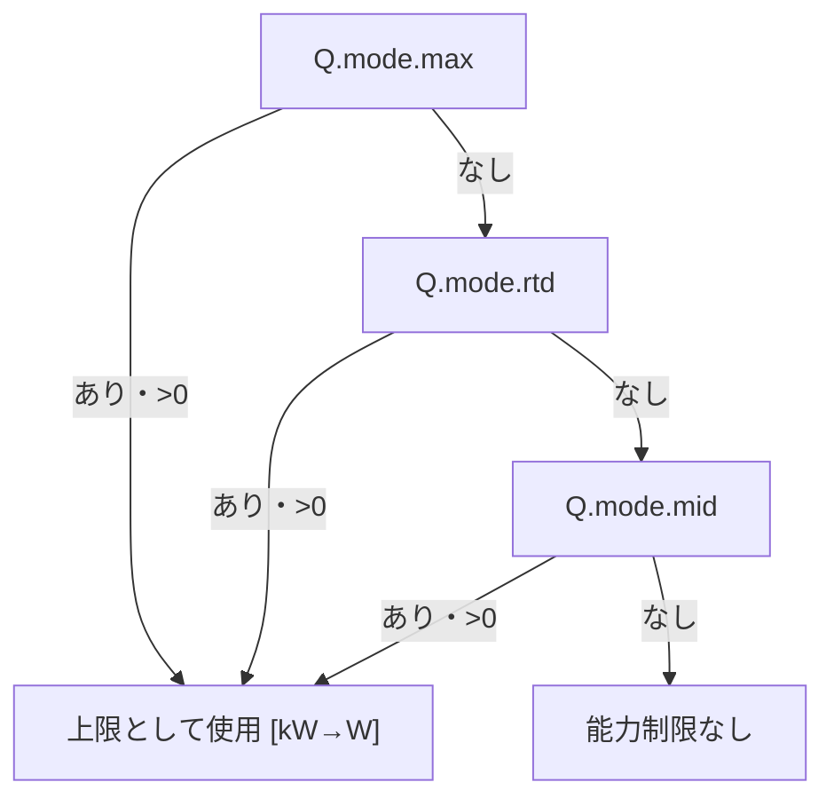
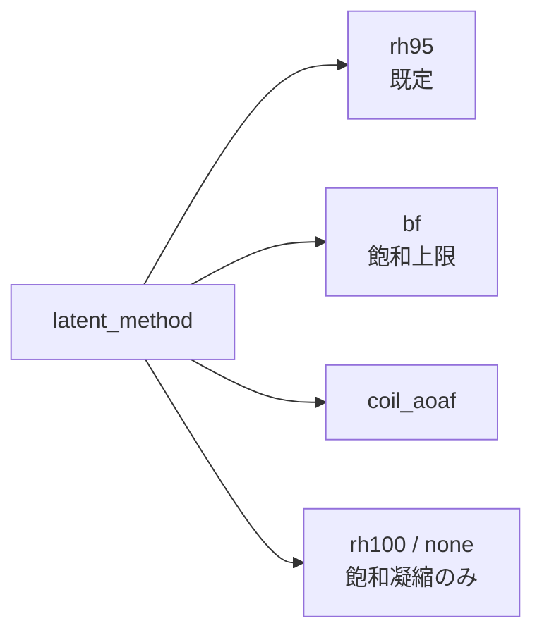

# エアコン仕様（ac_spec）リファレンス

> **実装契約** — 使い方は [空調のモデルと制御](../../docs/aircon_model_and_control.md)。入力の意味は [入力JSONの組み立て](../../docs/ai_input_guide.md)。

エアコンモデル別の `ac_spec` の形と、solver が参照する能力上限キーの一覧です。

- 制御の流れ・能力超過時の補正: [`aircon_control_overview.md`](aircon_control_overview.md)
- 各モデルの式・入力出力: [`acmodel_overview.md`](acmodel_overview.md)
- builder 入力での空調設定: [`builder_json.md`](builder_json.md) の「aircon」節

---

## 1. 共通事項

### 1.1 モデル指定

| 指定元 | キー | 説明 | デフォルト |
|--------|------|------|------------|
| builder 入力 | `aircon.model` | COP/電力推定に使うモデル種別 | 未指定時 **RAC** |
| solver 入力 | `nodes[].model` | 同上（parser が未指定時 **RAC** を適用） | - |

有効な値: `CRIEPI`, `RAC`, `DUCT_CENTRAL`, `LATENT_EVALUATE`

### 1.2 能力上限の参照（solver 側）

能力超過チェック（`checkAndAdjustCapacity`）で使う「最大処理熱量」は、次の優先順で取得します。

1. **`Q.<mode>.max`**（cooling / heating ごと） [kW]
2. **`Q.<mode>.max` が無い場合** → **`Q.<mode>.rtd`** [kW]（定格。DUCT_CENTRAL では通常いちばん大きい）
3. **`rtd` も無い場合** → **`Q.<mode>.mid`** [kW]（最終フォールバック）

いずれも無い機種は能力制限を掛けません（上限なし）。

### 1.3 潜熱計算方式（`latent_method`）

`ac_spec` では潜熱処理の方式を次で指定できます。

- `latent_method: "rh95"`（**デフォルト**）  
  吹出温度 `Tout` から吹出空気 RH を 95% として `supplyX` を決める
- `latent_method: "bf"`  
  バイパスファクタ法で `supplyX` を計算  
  BF は `bf` / `BF` / `bypass_factor` で指定（省略時 `0.2`、許容範囲 `0.0..0.99`、範囲外は入力エラー）。
  吹出RHが100%を超える場合は、温度を保持して飽和上限まで凝縮させ、その潜熱を能力・電力に含める。
- `latent_method: "coil_aoaf"`（別名: `"aoaf"`, `"literature"`）  
  コイル前面風速・有効表面積を用いる文献式（4.2.1）に基づく潜熱評価。
  - 追加パラメータ:
    - `Af` または `coil_face_area` : 実質コイル前面面積 [m²]（既定 `0.133`）
    - `Ao` または `coil_surface_area` : コイル有効表面積 [m²]（既定 `4.84`）
  - 顕熱処理量 `Hs` [W] と吸込/吹出条件から `Hr` [W] を評価し、`Q_L` および `supplyX` を決定する
- `latent_method: "rh100"`（`"none"` と同義）
  吸込絶対湿度を引き継ぎ、吹出温度で過飽和になる分だけ凝縮する。
- `latent_method: "ideal_coil"`
  湿度優先・温湿度満足の理想コイル用。新モードでは省略時もこの方式となり、rh100/noneも同義。新モードとrh95/bf/coil_aoafの組合せは未対応のため入力エラー。

未知の方式名、非有限値、負またはゼロのコイル面積は入力エラー。

補足:

- 顕熱・潜熱とも単位は [W]
- 能力上限判定は **全熱（`Q_S + Q_L`）** で実施

---

## 2. モデル別 ac_spec の形

### 2.1 CRIEPI

- **必須**: `Q`, `P` の cooling/heating × **min, rtd, max**
- **必須**: `V_inner`, `V_outer` の cooling/heating × **rtd**（風量 [m³/s]）
- 単位: `Q` / `P` は [kW]、風量は [m³/s]

能力上限: **`Q.<mode>.max`** を推奨（`mid` は CRIEPI では通常使わない）。

カタログの `Q.<mode>.min` は性能同定用です。制御用の最低能力は `min_process.{heating,cooling}` [kW] です（任意上書き）。未指定時は **`0.1 × Q.rtd`**（無ければ `Q.max`）。設定維持中の室負荷がモードと同符号でその 1.2 倍以下（かつ約 1 W 超）なら停止せず最低能力分を処理し、一度入ったらその時間ステップの終わりまで維持します。逆符号やほぼ零は停止します。`Q.rtd` も `Q.max` も無い機種は約 1 W の符号判定のままです。

最小形の例は `docs/acmodel_overview.md` の「CRIEPI向けの例」を参照。

---

### 2.2 RAC

- **必須**: `Q`, `P` の cooling/heating × **rtd, max**
- **任意**: `dualcompressor`（bool、容量可変型の切り替え）
- 単位: `Q` / `P` は [kW]

能力上限: **`Q.<mode>.max`** を指定するのが一般的。

制御用の最低能力は `min_process.{heating,cooling}` [kW]（上記 CRIEPI と同じ扱い。未指定時は `0.1×Q.rtd`）。カタログに `Q.min` があっても ON/OFF には使いません。

---

### 2.3 DUCT_CENTRAL

- **必須**: 使用する運転モードごとに `Q.min/mid/rtd`、`P.rtd`、`P_fan.rtd`、`V_inner.mid/rtd/dsgn`。AUTOは冷暖房の両方が必要。
- 数値は有限値とし、`0 <= Q.min < Q.mid < Q.rtd`、`P.rtd > P_fan.rtd >= 0`、風量は正値。
- OFF送風は冷房側の `P_fan.rtd` と `V_inner.dsgn` を使用し、暖房専用機では暖房側を使用。停止風量が0ならOFF用の冷房仕様は不要。
- 単位: `Q` / `P` / `P_fan` は [kW]、風量は [m³/s]
- 運転点入力 `InputData` では `V_vent`（換気分, [m³/s]）を使用可能。`V_outer` とは別入力で、既定は `0`。
- 任意の制御入力: `min_process.{heating,cooling}` [kW]。未指定時は `0.1×Q.rtd`（無ければ `0.1×Q.max`）。小負荷は最低風量を確保し、実際の顕熱処理量は室の熱収支による。
- solver 制御では `Q.<mode>.rtd` と `V_inner.<mode>.dsgn` を使って、処理熱量連動の送風量補正を行う（`Q=0 -> vol_zero`（既定0）, 正の負荷では `V=V_dsgn*max(Q,min_process)/Q.rtd` を上限比1まで用いる, `Q=Q_rtd -> V=V_dsgn`）。能力制限中・未達は `Q.max`/`rtd`/`mid`（未達は 0.5 K 超で入り、設定到達まで維持）、設定維持中は室負荷 `|required_heat_w|`。カタログ `Q.min` は風量床に使わない。
- この比の載せ方は二つある。`vol` のみなら還気・吹出の `fixed_flow`。`p_max`・`p1`・`q1`・`q_max` が揃えばファン枝を速度比で縮め、実風量は圧力計算の交点。同じ枝には両方載せない。詳細は [`aircon_control_principles.md`](aircon_control_principles.md) §5.3。

能力上限: **`Q.<mode>.max`** があればそれを使用。無い場合は **`Q.<mode>.rtd`**。それも無い場合は **`Q.<mode>.mid`**。

---

### 2.4 LATENT_EVALUATE

- **必須**: `Q`, `P` の cooling/heating × **rtd, mid, min** 等
- **必須**: `P_fan`, `V_inner` の cooling/heating × **rtd, mid, dsgn** 等
- 単位: 上記と同様 [kW], [m³/s]

能力上限: **`Q.<mode>.max`** または **`Q.<mode>.mid`**（仕様に合わせてどちらか一方でよい）。

---

## 3. 一覧表（能力上限キー）

| モデル | 能力上限に使うキー | 備考 |
|--------|--------------------|------|
| CRIEPI | `max` | min/rtd/max を揃えて指定する想定 |
| RAC | `max` | rtd + max が一般的 |
| DUCT_CENTRAL | `max` → `rtd` → `mid` | 定格 `rtd` を優先（mid のみの仕様も可） |
| LATENT_EVALUATE | `max` → `rtd` → `mid` | 同上 |

---

## 4. 関連ドキュメント

- `docs/aircon_control_overview.md` — エアコン制御・能力超過時の補正
- `docs/acmodel_overview.md` — 各モデルの式・入力出力・参考文献
- `docs/builder_json.md` — builder の `aircon` と `ac_spec` の渡し方
