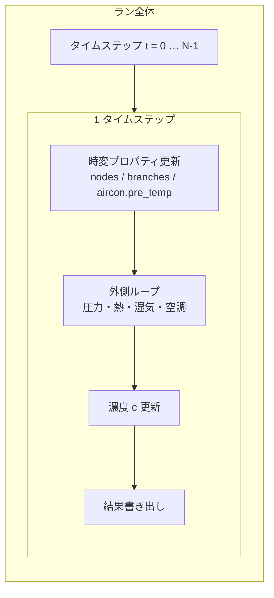
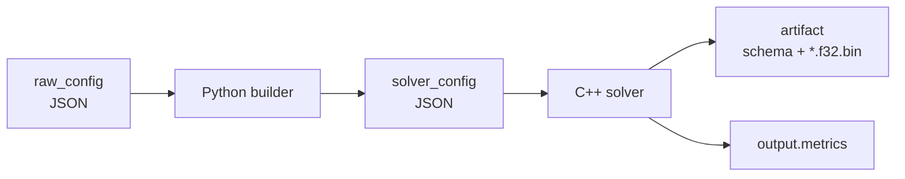
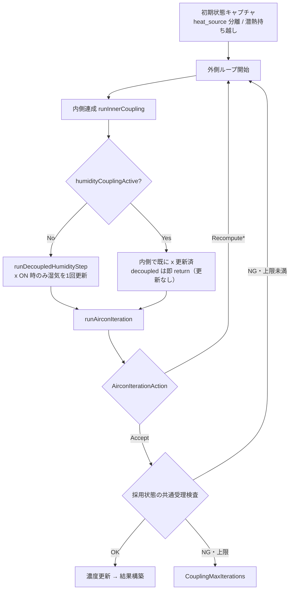
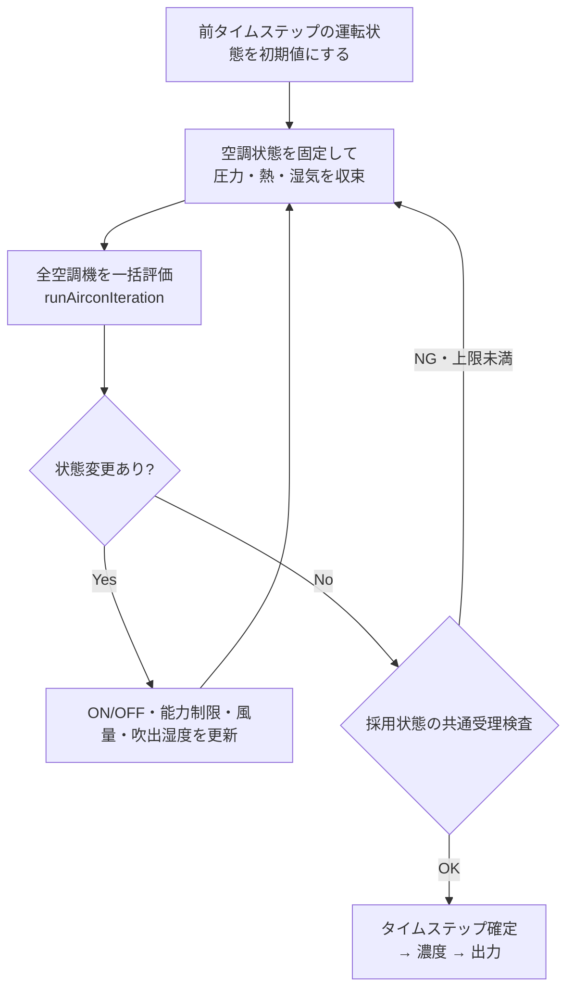
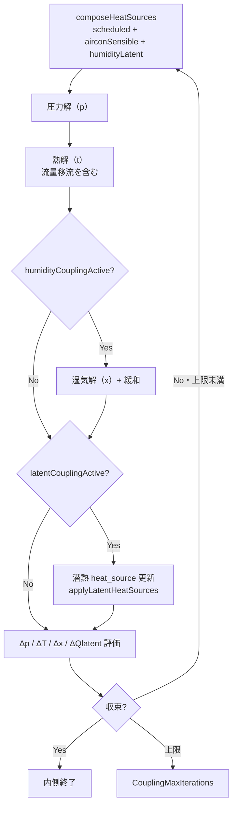
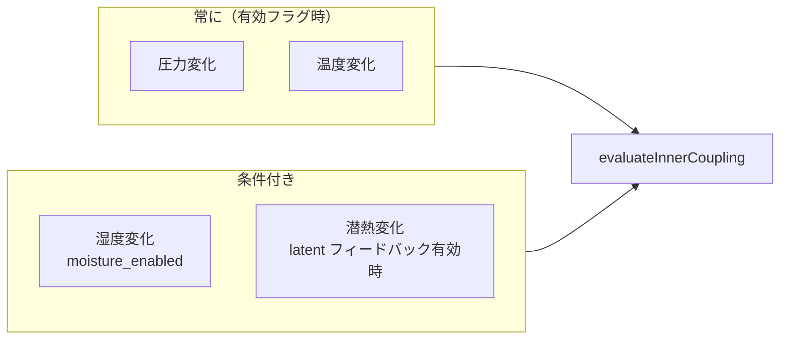
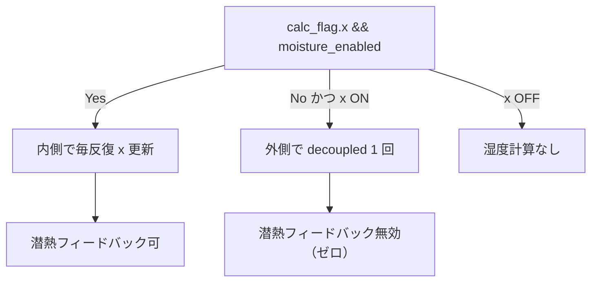
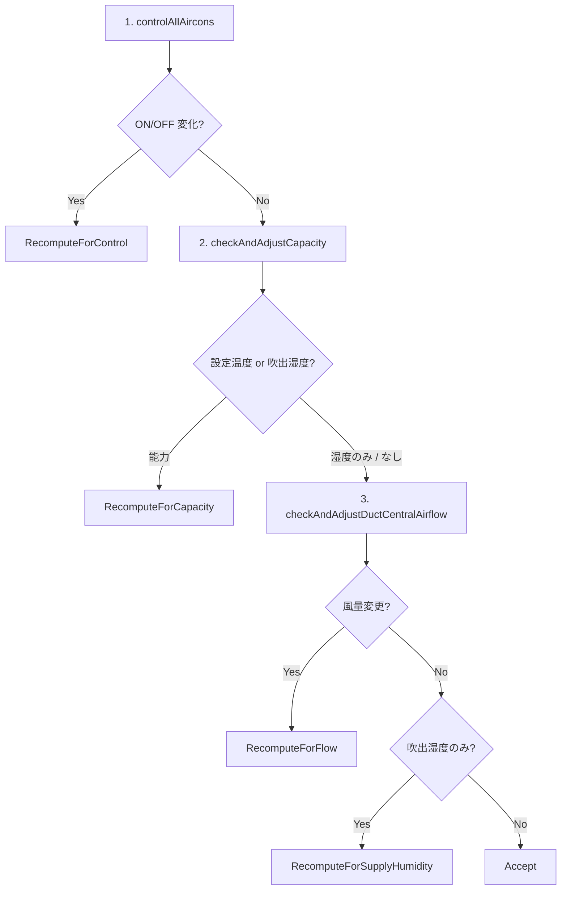
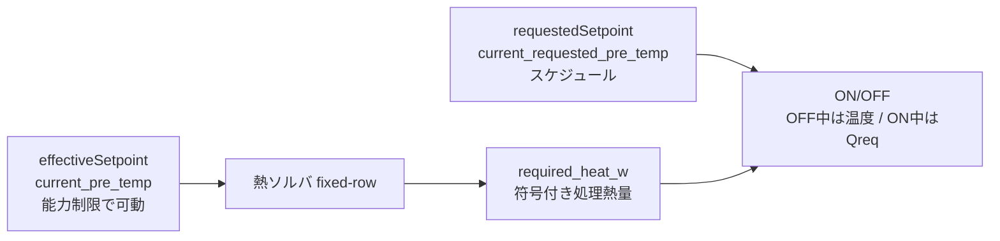
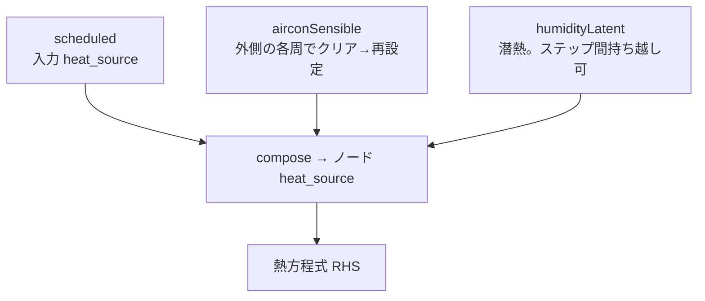

# 計算ループ構成（図解）

> **実装契約** — 使い方は [ドキュメント案内](../../docs/README.md)。文章の計算順は [simulation_overview.md](simulation_overview.md)。

実装の正本は `engine/solver/simulation_runner.cpp` 周辺です。入れ子のループを図で見るための文書です。空調の詳細は [aircon_control_overview.md](aircon_control_overview.md) です。

---

## 1. レイヤの入れ子（全体）

VTSimNX の計算は次の入れ子です。

| レイヤ | 実装の入口 | 何が変わるまで回るか |
|---|---|---|
| ラン | `vtsimnx_app` のステップループ | 全時刻 |
| 外側ループ | `runSimulation()` | 空調状態（ON/OFF・能力・風量・吹出湿度）が安定 |
| 内側連成 | `runInnerCoupling()` | 圧力・温度（＋条件により湿度・潜熱）が収束 |
| 空調評価 | `runAirconIteration()` | 1 回評価。変化があれば外側をやり直し |

---

## 2. パイプライン（入力 → 出力）

builder の役割は [`builder_json.md`](builder_json.md)、フラグは `simulation.calc_flag`（`p` / `t` / `x` / `c`）。

---

## 3. 1 タイムステップの骨格

`runSimulation()` の外側構造です。

要点:

- **`calc_flag.x=true` かつ `coupling.moisture_enabled=true`** のとき、湿気を内側で更新し、連成反復が必要な場合は湿度変化を収束判定に含めます。
- **`calc_flag.x=true` かつ `coupling.moisture_enabled=false`** のとき、`runDecoupledHumidityStep` は外側ループの各周で 1 回更新します。それ以外は即 return します。
- **濃度 `c`** は外側 Accept と共通受理検査の後、`calc_flag.c` が有効な場合に 1 回だけ更新します（空調判定には使いません）。

---

## 4. 外側ループ（空調制御ループ）

空調の特徴として、`set_node`（制御対象）と吸込・吹出空間を分離した**遠隔 set**（エアコン未設置室の温度制御）をサポートします。詳細は [`aircon_control_overview.md`](aircon_control_overview.md) 冒頭。

上限は `maxAirconControlIterations > 0` ならその値、それ以外は `maxInnerIterations` です（内部定数名）。`maxCouplingIterations` にはフォールバックしません。空調状態が上限までに安定しない場合は `AirconMaxIterations`、空調状態は安定しても採用状態の共通受理検査が上限まで通らない場合は `CouplingMaxIterations` で終了します。

再計算理由の優先順位（ビットフラグ `AirconRecomputeReason`）:

| アクション | 典型トリガ |
|---|---|
| `RecomputeForControl` | ON/OFF 変化 |
| `RecomputeForCapacity` | 実効設定温度の能力制限補正 |
| `RecomputeForFlow` | DUCT_CENTRAL の `fixed_flow` 補正（処理熱確定後） |
| `RecomputeForSupplyHumidity` | 吹出絶対湿度のみ変化 |
| `Accept` | 上記なし |

メトリクスの読み方は [`aircon_control_overview.md`](aircon_control_overview.md) の「今後の方針」節を参照。

---

## 5. 内側連成（圧力・熱・湿気）

`runInnerCoupling()` の 1 反復です。

### 5.1 何が収束判定に入るか

- 最小反復: 通常 1。空調 ON/OFF・mode 署名が変わった直後の外側 1 周目は **最低 2 回**（ウォームスタート無効化）。
- 上限: `maxCouplingIterations > 0` ならその値、それ以外は `maxInnerIterations`（内部定数名）。
- 例外: 圧力・温度・内側連成湿度の有効な状態量が 1 つ以下なら、最小反復数によらず 1 回で内側を終了します。ただし、初回の圧力未収束は先にエラー判定します。
- 連成収束は有効な各状態量について、最大絶対変化量が許容値未満（`Δp < pTol`, `ΔT < tTol`, `Δx < xTol`）であることを要求します。各許容値は対応する `coupling*Tolerance` が正ならその値、それ以外は `convergenceTolerance` です。
- 潜熱有効時は、緩和後の更新量と「緩和前の目標 − 前反復の適用値」の両方を、絶対・相対許容値で判定します。尺度には緩和前の目標も含め、小さい緩和係数による偽収束を防ぎます。許容値は `couplingLatentAbsoluteToleranceW` / `couplingLatentRelativeTolerance` です。
- 上限回でも先に収束を判定し、未収束の場合のみ `CouplingMaxIterations` で終了します。

内側の圧力→温度は Picard（Gauss–Seidel）です。空調 ON や風量の急変で温度と圧力が周期 2 振動・発散することがあるため、**湿気移流は切らず**、熱ソルバ後の温度だけを緩和します。圧力は緩和した温度（密度・浮力）から次反復で解き直します。

- `simulation.coupling.temperature_relaxation`: 温度緩和の上限 `(0,1]`（既定 `1.0`）
- 温度変化が連成温度許容誤差の10倍を超え、かつ前反復から減っていないとき係数を 0.5 以下にする（設定した緩和上限は維持）。1 K 未満でも未収束の振動を対象にし、許容付近の単調減少は緩和しない
- 1 回の混合変化量は 20 K まで（生の ΔT が大きいときの発散防止）
- この混合は内側 Picard（有効状態量が 2 つ以上）のときだけ。温度だけのステップでは熱解をそのまま採用する（空調 ON 直後のコイル ΔT を切らない）
- `DUCT_CENTRAL` の暖房・冷房・AUTOで、熱候補の必要負荷が増風量を要求する場合、ファンPQまたは固定流量枝を先に更新する。圧力計算無効の固定流量も対象とする。候補温度を前反復へ戻して候補負荷を無効化し、物理求解からやり直す。この再試行も内側反復上限に含める。能力探索中・停止中は対象外で、減風量は外側制御に残す
- 上記の風量更新がない熱候補が非物理（`current_t` が NaN/Inf、または -80〜120 °C の外）なら `thermal_not_converged` で停止し、ノード名と値を記録する。前反復へ戻して変化量ゼロを収束扱いにせず、最終採用には更新後の風量で解いた物理範囲内の熱解を要求する
- 湿気未知ノード（`humiditySolveNode` がtrue）の絶対湿度が非物理（NaN/Inf、または -1e-6〜0.5 kg/kg(DA) の外）なら `humidity_not_converged` で停止する。非連成湿気計算にも適用する
- 処理熱量が上限の2倍を超えても能力判定を省略しない。遠隔 `set` は入口・設定温度だけの近似を避け、実回路を再求解する能力探索を行う
- 処理熱量が上限の 0.1%+1 W 以内なら能力探索に入らず、不足側の bracket 継続もしない

### 5.2 湿度・潜熱の分岐（概念）

#### 条件と状態の扱い（現行仕様）

ここでいう潜熱は `humidityLatent` による熱源フィードバックです。

| 条件 | 湿度更新 | 潜熱フィードバック |
|---|---|---|
| `calc_flag.x=false` | 更新なし | 無効 |
| `x=true`, `moisture_enabled=false` | 外側の各周で 1 回 | 無効。有効な潜熱モードとの併用はパーサが拒否 |
| `x=true`, `moisture_enabled=true`, `t=false` | 内側で更新 | 無効。有効な潜熱モードとの併用はパーサが拒否 |
| `x=true`, `moisture_enabled=true`, `t=true` | 内側で更新 | `latent_coupling_mode` が `from_humidity_change` または `from_phase_change` の場合に有効。`disabled` は無効 |

- 非連成の各更新前に、未知湿度ノード（`humiditySolveNode` がtrue）の x と材料含水量 w をタイムステップ開始時の値へ戻します。外側反復の回数だけ時間積分を重ねないためです。固定湿度境界（`humiditySolveNode` がfalse）は戻さず、除湿中の空調吹出湿度などの外側反復による更新を保持します。
- 内側連成でも時間積分の基準 x は `initial.humidityX` に固定し、w を `initial.moistureW` に戻してから解きます。反復直前の湿度は緩和と変化量評価に使います。
- 潜熱有効時は、湿気更新・緩和後に潜熱を更新し、次の内側反復の熱計算へ渡します。非連成関数にも潜熱更新の分岐がありますが、現行の `latentCouplingActive` が `moisture_enabled=true` を要求するため到達しません。
- `from_humidity_change` は実験・非推奨のモードです。材料相変化の潜熱を扱う `from_phase_change` と同じ物理モデルとして扱わないでください。

条件の実装は [`simulation_inner_coupling.h`](../solver/simulation_inner_coupling.h)、更新順序は [`simulation_inner_coupling.cpp`](../solver/simulation_inner_coupling.cpp)、入力制約は [`sim_constants_parser.cpp`](../solver/parser/sim_constants_parser.cpp) を参照してください。
湿気回路網の詳細は [`moisture_network_phase1.md`](moisture_network_phase1.md)。

---

## 6. 空調評価の 3 段階

`runAirconIteration()` は早期 return します（後段を飛ばす）。  
処理熱（能力制限）を先に確定し、DUCT 風量補正は最後に行う（同時更新による振動を避ける）。最低能力付近のON/OFFホールドは `min_process` の1.2倍で入る。DUCTの必要負荷は上書きせず、風量は `max(必要負荷, min_process)` に比例する連続な下限付きの則で決める。ファンPQの外側更新は速度比を旧値と目標の中点へ進め、緩和前の目標差で収束判定する。
能力制限中・設定未達の風量比は `Q_max`、設定維持中は `|required_heat_w|`（無いときは `Q_max`）。未達は 0.5 K を超えて入ったら設定到達まで `Q_max` を維持する。計測コイル熱は使わない（`V∝Q_meas∝V` の 0 縮小を防ぐ）。内側連成では温度に加え、未知湿度ノードの絶対湿度も物理範囲を検査し、範囲外の候補を成功として採用しない。

各段階は `AirconStateProposal` を積み上げ、理由を OR 集約します。

設定温度の二系統:

ON 中かつ `set_node` が実効設定近傍にあるときだけ `required_heat_w` を使います。  
室温が大きく外れている解では温度バンドへフォールバックし、ON/OFF 振動を防ぎます。能力探索が最終検証後も上限を満たせない場合は Accept せず例外終了します。

`required_heat_w` は通常、set 熱収支から空調寄与を除いて求めます。  
`set ≠ in/out`（遠隔 set）では dual-row 後に set 収支が ≈0 となるため、コイル処理熱量へフォールバックします。

---

## 7. 熱源の分離（外側・内側で共有）

外側ループは熱源を役割別に持ちます。

- 外側ループの **周の先頭**で `airconSensible` をゼロ化してから再合成します。
- タイムステップ開始時、潜熱連成が有効で保存ベクトルと現ノード数が一致するときだけ、前ステップの `humidityLatent` を初期値に使います。それ以外はゼロです。外側収束後、有効なら保存し、無効なら保存値を消去します。
- 空調制御直前にノード `heat_source` をゼロ化する処理は行いません（正本は `SeparatedHeatSources`）。
---

## 8. コード対応表

| 図の箱 | 主なファイル |
|---|---|
| タイムステップ全体 | `simulation_runner.cpp` |
| 内側連成 | `simulation_inner_coupling.cpp` |
| 圧力+熱 1 回 | `simulation_coupled_step.cpp` |
| 収束判定 | `simulation_coupling_control.cpp` |
| 空調 3 段階 | `simulation_aircon_iteration.cpp` |
| ON/OFF・能力・風量 | `aircon/aircon_controller.cpp` ほか |
| メトリクス | `simulation_metrics.h` |

---

## 9. 関連ドキュメント

- [`simulation_overview.md`](simulation_overview.md) — 計算順の文章版
- [`aircon_control_overview.md`](aircon_control_overview.md) — 空調制御・メトリクス
- [`moisture_network_phase1.md`](moisture_network_phase1.md) — 湿気・潜熱
- [`theory_basics.md`](theory_basics.md) — 物理の全体像

仕様と既存テストの対応、および未確認の検証範囲は [仕様・実装・テスト対応表](specification_traceability.md) を参照してください。

## 収束診断

温度・湿度・潜熱の連成判定は、緩和前の候補と前反復状態との差も要求する。小さい緩和係数によって更新量だけが小さくなっても成功にしない。失敗入力の保存と再実行は [収束診断手順](convergence_diagnostics.md) を参照。

## 採用状態の共通成功判定

`AirconIterationAction::Accept` は制御状態が安定したことを表す。出力前に `simulation_runner.cpp` の `acceptedStateConverged` が、実際に採用する状態を以下の条件で検査する。

| 対象 | 最終状態の検査 |
|---|---|
| 圧力 | 有効時に圧力ソルバの収束フラグを要求 |
| 温度・熱 | 物理範囲、固定温度条件、更新済み流量・湿度で再評価した熱収支残差を検査。候補解のキャッシュを成功根拠にしない |
| 吹出湿度 | 全冷房方式に共通の飽和上限と、min(連成湿度許容値, 1e-7 kg/kg)による緩和前の境界欠損を検査。境界変更時は収支を再求解 |
| 水分 | 時刻開始時の保有水分に対し、現在の流量・湿度・材料移動・発湿から収支を再評価。対角係数で正規化した絶対欠損と、線形ソルバと同じ行スケーリング・右辺ノルムによる相対残差の両方を要求 |
| 潜熱 | 現状態から再計算した緩和前の潜熱と、熱計算に適用した潜熱との差を要求 |
| 空調能力 | 現状態の実処理全熱が上限の許容差内であることを再確認。未解決の超過は `capacity_constraint_unresolved` |

熱・水分・潜熱が未達なら、同じ時刻開始状態を基準に外側反復へ戻る。反復上限で未達なら成功とせず停止する。濃度計算、応答係数履歴の確定、結果出力はこの検査の後で行う。

湿気の未知数は `humiditySolveNode` に統一し、除湿中だけ空調吹出を固定境界とする。暖房・停止・除湿不要の冷房は混合未知数であり、求解・緩和・復元・物理検査に同じ役割を用いる。吹出湿度を更新するのは能力判定段階だけとし、風量判定で重複更新しない。

`log.verbosity > 0` では受理した各時刻に `[受入検査] 最終状態整合` と、熱・湿度・潜熱の残差を記録する。回帰試験は `engine/tests_py/test_convergence_acceptance.py` が水分保存、遠隔制御の能力上限、暖冷房×ファン/固定流量の負荷急変、潜熱の偽収束を検証する。

吹出の飽和上限は共通成功判定の対象である。温度優先の `pre_rh` は室RH未達の評価だけに使い、冷却に伴う除湿量は `latent_method` で求める。湿度優先・温湿度満足の室RH制御は別途水分収支から要求を求める。これらの制約を満たしても、実機のコイル特性や適用範囲を保証するものではない。

### 制御候補と吹出湿度の反復上限

同じ制御候補の吹出湿度収束には `max_coupling`、温度・風量・ON/OFFの変更には
`max_aircon_control` を用いる。吹出湿度だけの再求解では制御探索の回数枠を消費しない。
湿度境界が上限内で安定しなければ `humidity_not_converged` で停止する。
計測の `outer_iterations` はすべての物理再求解を数えるため、制御探索上限を超える場合がある。

停止ファンに接続する圧力未知の行き止まり枝は、収支から厳密に流量0となる。
圧力解の許容誤差内に残った受動枝の微小流量を0へ戻し、全枝の収支を再検査してから
熱・湿気・濃度へ同じ流量を渡す。指定された固定流量や流れ続ける循環枝は消さない。
孤立した熱源なし・容量なしの温度未知数は前回温度を保持する。孤立ノードに熱源があれば
熱計算失敗とし、便宜的な温度固定で不成立の熱収支を隠さない。
